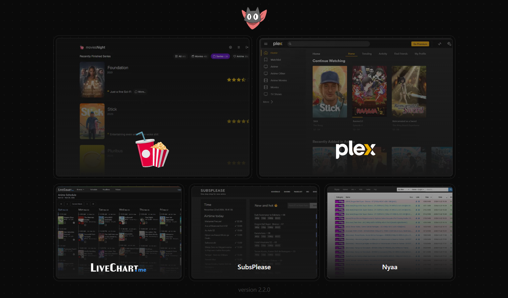

# Homecloud Dashboard

A personal start page for my home network. It's a small static site, served on the local network, with one-click links to the media services I use every day: self-hosted ones like Plex and a few public sites I check often.



## Links on the dashboard

| Tile         | Destination                                   | Type                |
| ------------ | --------------------------------------------- | ------------------- |
| movieNight   | `https://movies.juliuszlioba.com/`            | Personal web app    |
| Plex         | `https://app.plex.tv/`                        | Media server        |
| LiveChart.me | `https://www.livechart.me/schedule`           | Anime schedule      |
| SubsPlease   | `https://subsplease.org/`                     | Release tracker     |
| Nyaa         | `https://nyaa.si/?f=0&c=1_2&q=`               | Release index       |

Each tile shows a preview screenshot of the site behind it, and every link opens in a new tab.

## Tech stack

- [Astro 7](https://astro.build): static site generation, plus `astro:assets` for responsive WebP screenshots
- [Tailwind CSS 4](https://tailwindcss.com), loaded through `@tailwindcss/vite`
- `clsx`, `tailwind-merge` and `tw-animate-css` for class helpers and animations
- [pnpm](https://pnpm.io) as the package manager

## Requirements

- Node.js 22 or newer (developed on Node 24)
- pnpm 12 (the exact version is pinned in `packageManager` in `package.json`; `corepack enable` installs it)

## Getting started

```sh
pnpm install
pnpm dev
```

The dev server runs at <http://localhost:4321>. To open it from other devices on the LAN, run `pnpm dev --host`.

## Commands

| Command        | Action                                          |
| -------------- | ----------------------------------------------- |
| `pnpm install` | Install dependencies                            |
| `pnpm dev`     | Start the local dev server at `localhost:4321`  |
| `pnpm build`   | Build the production site into `./dist/`       |
| `pnpm preview` | Preview the production build locally            |
| `pnpm astro …` | Run Astro CLI commands (`astro check`, etc.)    |

## Deploying on the local network

`pnpm build` writes a fully static site to `dist/`. Any web server on the home network can serve it, for example nginx, Caddy, or a NAS web server.

To try it quickly from another device:

```sh
pnpm build
pnpm preview --host
```

## Project structure

```text
├── public/
│   ├── favicon.svg
│   └── images/                 # Service logos (SVG)
├── src/
│   ├── assets/screenshots/     # Preview screenshots used as tile backgrounds
│   ├── components/
│   │   └── ButtonLink.astro    # Link tile with optional screenshot background
│   ├── layouts/
│   │   └── main.astro          # Base HTML layout
│   ├── lib/utils.ts            # `cn()` class-name helper
│   ├── pages/index.astro       # The dashboard page
│   └── styles/global.css       # Tailwind entry and theme
├── docs/screenshot.png         # Screenshot used in this README
└── astro.config.mjs
```

## Adding or changing a tile

1. Put a screenshot of the target site in `src/assets/screenshots/` (16:10 JPG works best).
2. If the tile has a logo, put it in `public/images/`.
3. In `src/pages/index.astro`, import the screenshot and add a `ButtonLink`:

   ```astro
   ---
   import myShot from "@/assets/screenshots/example.com.jpg";
   ---

   <ButtonLink href="https://example.com/" screenshot={myShot} sizes={bottomSizes}>
     Example
   </ButtonLink>
   ```

`ButtonLink` props:

| Prop         | Type            | Description                                                      |
| ------------ | --------------- | ---------------------------------------------------------------- |
| `href`       | `string`        | Link target (opens in a new tab)                                 |
| `screenshot` | `ImageMetadata` | Optional background image, served as responsive WebP             |
| `sizes`      | `string`        | Optional `sizes` attribute for the responsive image              |

On large screens the layout fits a single screen: two large tiles on top and three smaller ones below. On smaller screens the tiles stack.

## Updating the README screenshot

Build and preview the site, then capture it with headless Chrome:

```sh
pnpm build && pnpm preview --port 4329
# in another terminal
chrome --headless=new --hide-scrollbars --window-size=1440,900 \
  --virtual-time-budget=5000 --screenshot=docs/screenshot.png http://localhost:4329/
```
